<p align="right"><strong>中文</strong> · <a href="README.en.md">English</a></p>

# Primuse（猿音）

Primuse 把本地文件、NAS、媒体服务器、网盘和 Apple Music 里的音乐放进同一座曲库。在 iPhone、iPad、Mac 或 Apple TV 上听专辑、看逐字歌词、练伴唱，也可以订阅播客、按章节听书，或收藏网络电台。

**[Palveni 知识库 · Primuse 使用手册](https://palveni.com/zh-hans/knowledge?product=primuse)**

第一次使用可以从[连接来源到播放第一首歌](https://palveni.com/zh-hans/knowledge/primuse-kb-end-to-end-workflow-zh-hans)开始。按需查阅[网盘连接](https://palveni.com/zh-hans/knowledge/primuse-kb-connect-cloud-drives-zh-hans)、[歌词与封面匹配](https://palveni.com/zh-hans/knowledge/primuse-kb-metadata-artwork-scraping-zh-hans)、[离线下载](https://palveni.com/zh-hans/knowledge/primuse-offline)或[播放故障排查](https://palveni.com/zh-hans/knowledge/primuse-kb-troubleshoot-playback-zh-hans)。

<p align="center">
  <a href="https://g2.al/1">
    
  </a>
  <a href="https://apps.apple.com/cn/app/%E7%8C%BF%E9%9F%B3/id6761675450">
    
  </a>
</p>

## 文档索引

- [iPhone 与 iPad](#iphone-与-ipad) · [交流反馈与图标征集](#交流反馈)
- [中文更新日志](Docs/CHANGELOG.md) · [English Changelog](Docs/CHANGELOG.en.md)
- [应用截图](#应用截图) · [macOS 桌面版](#macos-桌面版) · [Apple TV 版](#apple-tv-版) · [Apple Watch 与系统集成](#apple-watch-与系统集成)
- [音乐源](#音乐源) · [播客、有声书与卡拉 OK](#播客有声书与卡拉-ok) · [电台、发现与个性化](#电台发现与个性化) · [播放与格式](#播放与格式) · [歌词与元数据](#歌词与元数据) · [资料库与同步](#资料库与同步)
- [快速开始](#快速开始) · [自定义刮削源](#自定义刮削源) · [项目结构](#项目结构) · [架构](#架构) · [许可证](#许可证)

## iPhone 与 iPad

- **自适应原生界面** — iPhone 使用标签式导航，并为横屏、分屏和折叠外屏提供紧凑布局；iPad 提供分栏资料库、双栏播放页和多窗口场景
- **完整移动资料库** — 导入“文件”App 中的歌曲、连接远程来源、扫描目录，并在本地、NAS、服务器与云端之间统一搜索、管理歌单和收藏电台
- **随身播放器** — 在封面、歌词、队列和多种沉浸画面之间切换，查看真实音质、调整速度与音效、选择 AirPlay 输出并手动修正元数据
- **后台与系统控制** — 支持后台音频、锁屏/控制中心、耳机和蓝牙按键；音量滑杆只调整 Primuse 自身音量，不会改动系统输出音量

## 应用截图

<p align="center">
  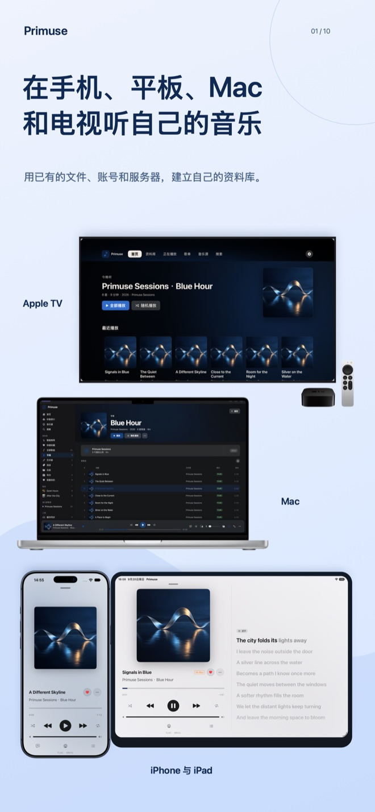
  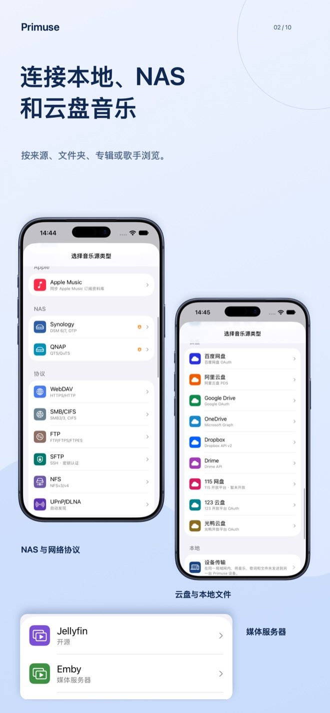
  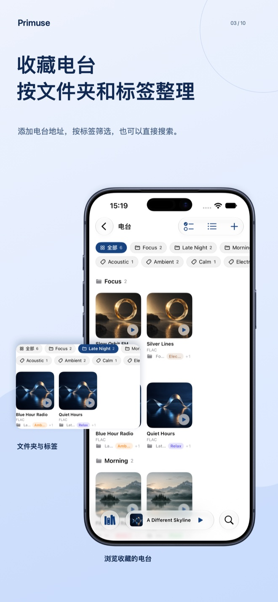
  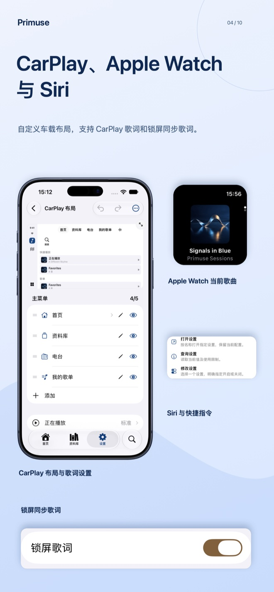
  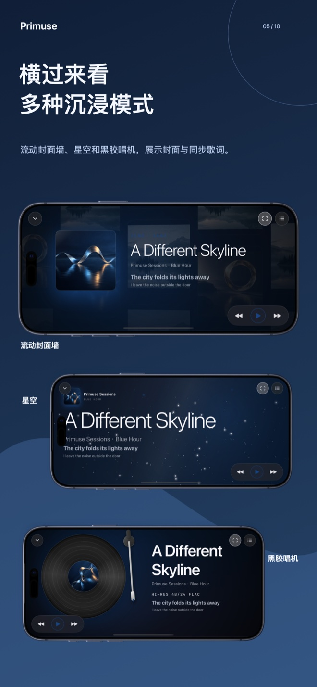
</p>
<p align="center">
  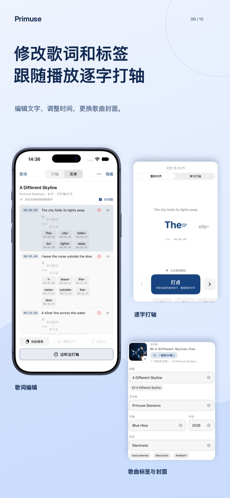
  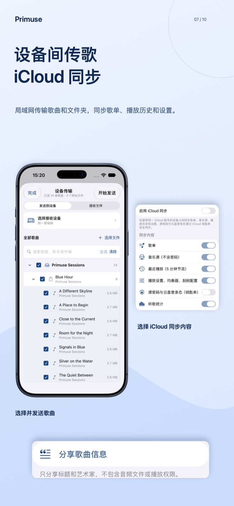
  
  
  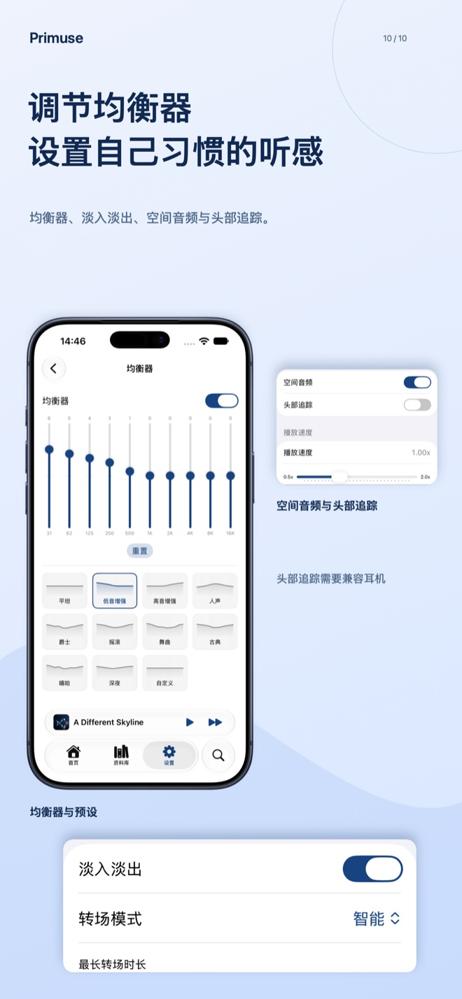
</p>

## macOS 桌面版

Mac 客户端采用原生桌面布局，并与 iPhone、iPad 和 Apple TV 共享资料库、音乐源、歌单与 iCloud 同步数据。

<table>
  <tr>
    <td align="center">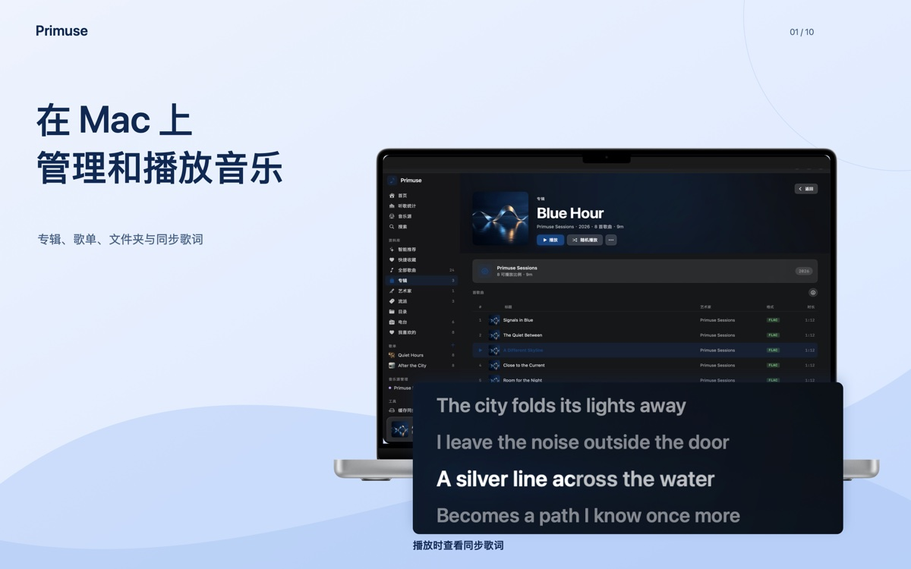<br/>桌面资料库与播放</td>
    <td align="center">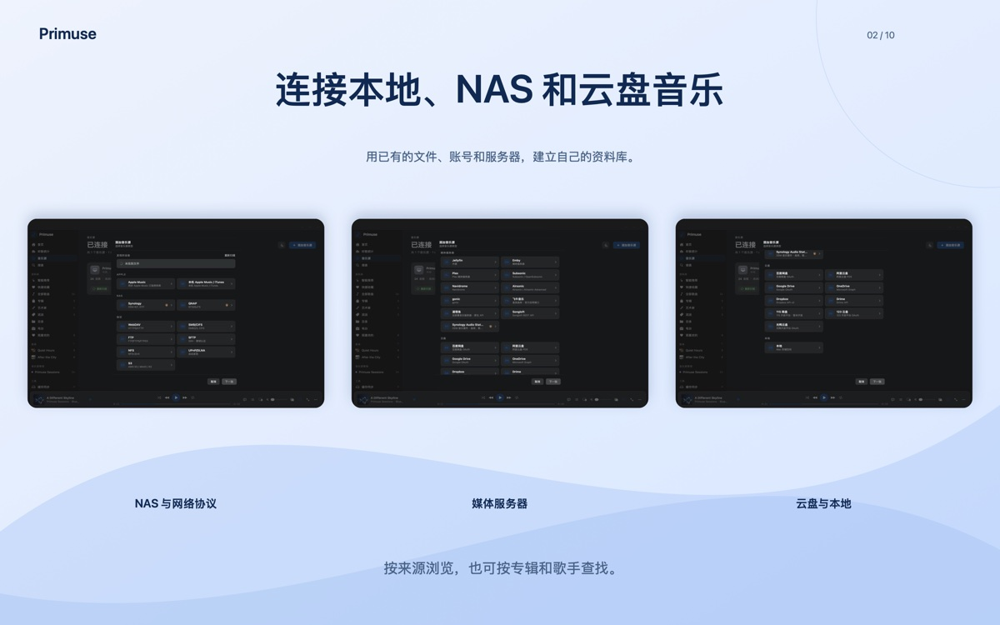<br/>音乐源管理</td>
  </tr>
  <tr>
    <td align="center">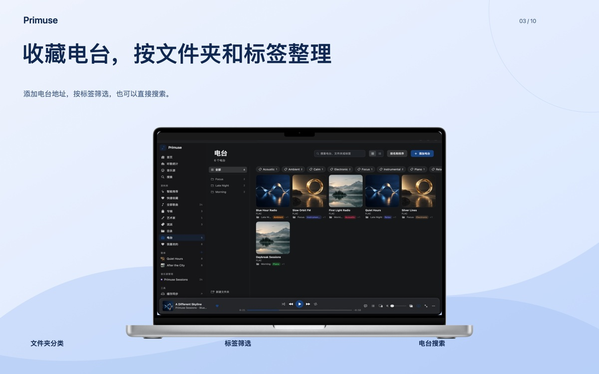<br/>电台文件夹与标签</td>
    <td align="center">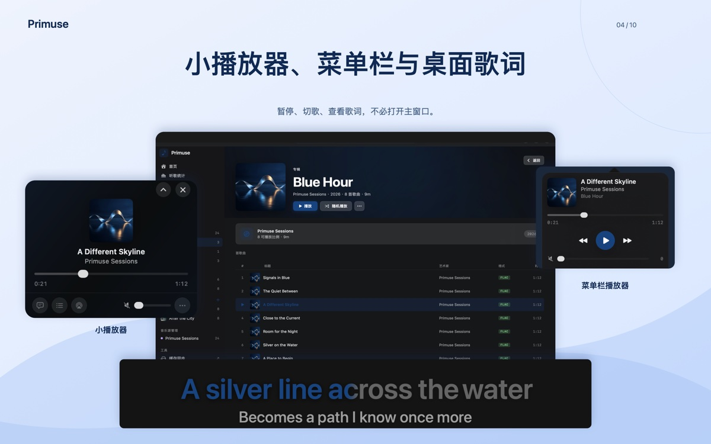<br/>小播放器、菜单栏与桌面歌词</td>
  </tr>
  <tr>
    <td align="center"><br/>全屏封面、歌词与沉浸画面</td>
    <td align="center">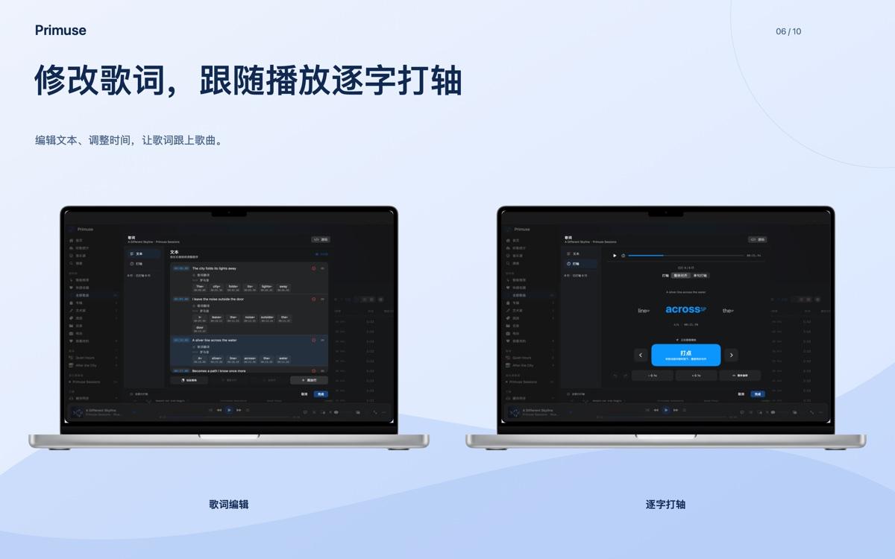<br/>歌词编辑与逐字打轴</td>
  </tr>
  <tr>
    <td align="center" colspan="2">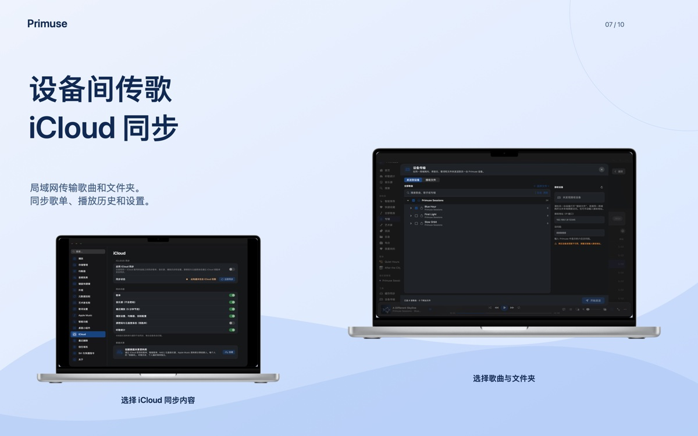<br/>设备互传与 iCloud 同步</td>
  </tr>
</table>

### macOS 专属能力

- **原生桌面界面** — 自定义标题栏、可折叠侧边栏、底部播放栏，以及面向大曲库优化的表格和搜索体验
- **迷你播放器与菜单栏播放器** — 在悬浮小窗、菜单栏弹窗和主窗口之间切换，随时查看歌词与队列
- **桌面歌词** — 独立悬浮歌词窗口，支持双行、单行、竖排、锁定和点击穿透
- **Apple Music / iTunes 资料库导入** — 读取 Mac 上 Music App 中可访问的歌曲和歌单；本地非 DRM 文件可直接播放
- **专业输出控制** — 选择音频输出设备，使用应用内音量，并可切换高保真或音效处理链
- **完整资料库工具** — 智能歌单、重复歌曲清理、标签编辑、歌单导入导出和独立批量刮削窗口
- **桌面小组件与多屏显示** — 正在播放、歌词、统计等 WidgetKit 小组件，以及外接屏大封面和大字歌词
- **DLNA 投送与系统控制** — 发现局域网播放器并投送，支持媒体键和自定义播放快捷键
- **外观自定义** — 浅色/深色模式、主题色、动态封面取色和多套应用图标

## Apple TV 版

Apple TV 客户端可以浏览整座曲库、直接连接多种音乐源，并通过 iCloud 或局域网从 iPhone 接收资料库、凭据和播放所需配置。

<table>
  <tr>
    <td align="center">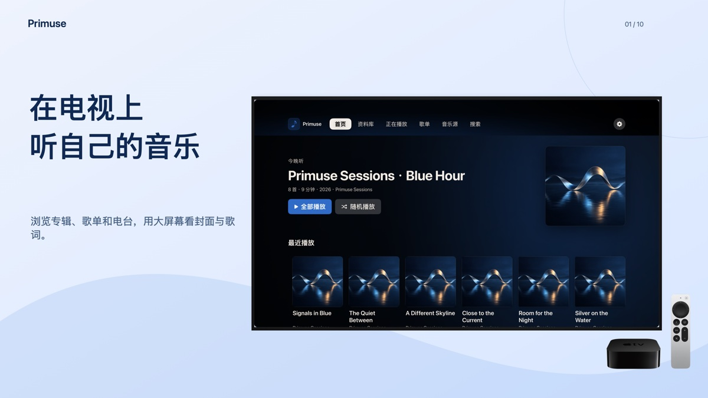<br/>在电视上听自己的音乐</td>
    <td align="center">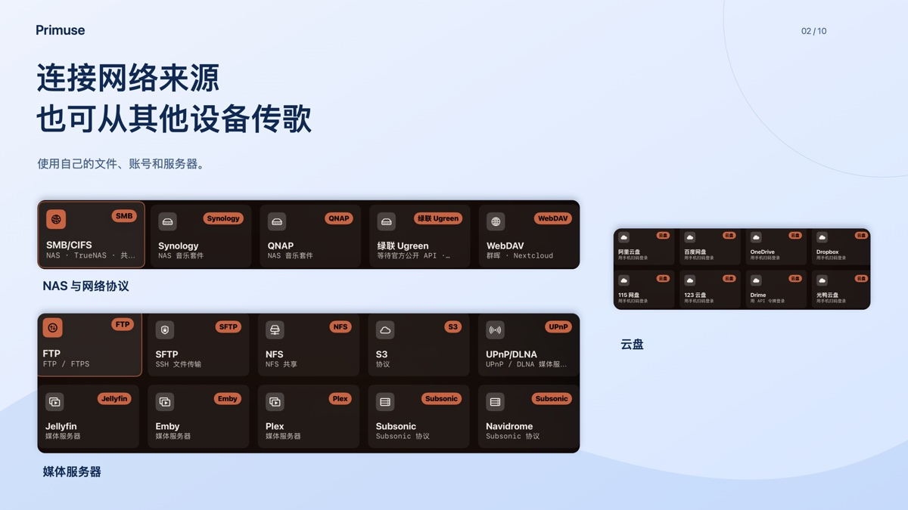<br/>音乐源直连与扫码传输</td>
  </tr>
  <tr>
    <td align="center">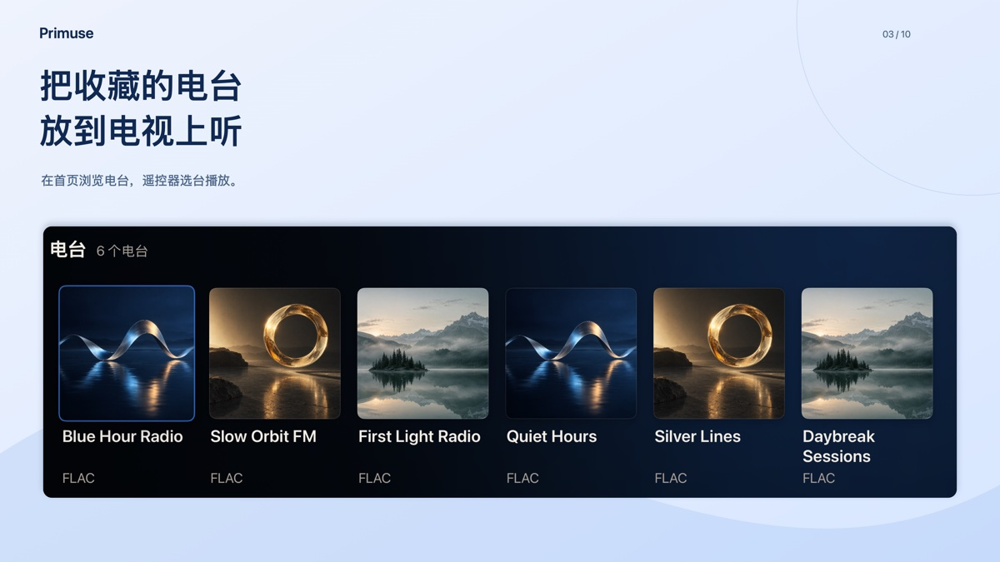<br/>收藏电台</td>
    <td align="center">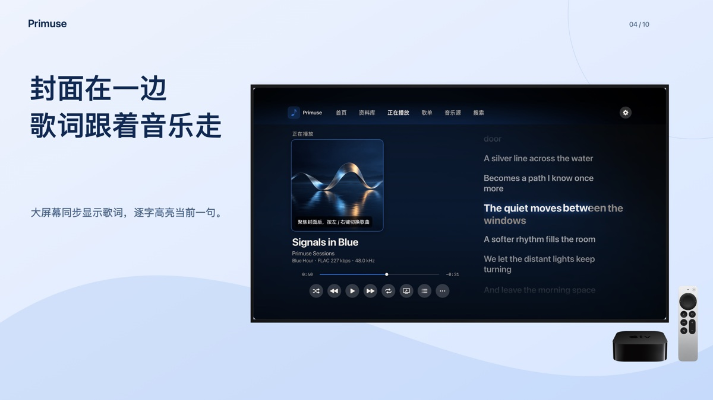<br/>封面与同步歌词</td>
  </tr>
  <tr>
    <td align="center" colspan="2">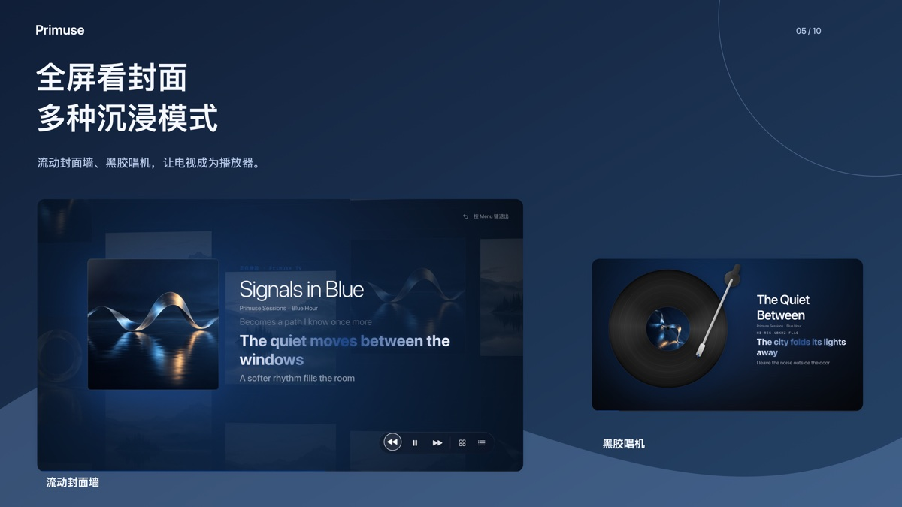<br/>全屏封面与沉浸画面</td>
  </tr>
</table>

### Apple TV 专属能力

- **大屏整库浏览** — 浏览专辑、艺术家、歌曲、歌单和电台，支持全部播放、整库随机播放与 Siri Remote 操作
- **来源直连与中继** — WebDAV、UPnP/DLNA、云盘和服务器源按各自协议解析；SMB、NFS、FTP 支持 TV 本机读取，其他部分来源可使用可选的 iPhone 局域网中继
- **扫码传输配置** — Apple TV 展示一次性二维码，iPhone 可在局域网内直接发送资料库快照、音乐源和加密凭据，不要求两台设备使用同一 Apple ID
- **凭据管理** — 支持 iCloud 同步、局域网配对传输，以及直接在 TV 上输入部分服务器账号
- **同步歌词** — 读取本地缓存、来源 Sidecar 或服务端歌词，显示逐行/逐字进度与翻译
- **播客、听书与伴唱** — 用遥控器选择单集、继续听书，或在全屏播放页进入伴唱舞台并与 iPhone 麦克风配对。
- **顶部展示** — 在 tvOS 主屏展示最近播放和专辑内容，并通过深层链接回到对应内容
- **多语言界面** — 支持简体中文、繁体中文、英语等 16 种语言

> Apple TV 的可播放路径取决于来源类型、凭据和中继设置。tvOS 现已具备 FFmpeg 兼容解码，可播放 WMA、DTS、TrueHD 等系统原生解码器不支持的格式。

## Apple Watch 与系统集成

- **Apple Watch** — 从表上控制 iPhone 的播放、选歌和进度，或把选中的歌曲传到手表，在 iPhone 不在身边时离线播放。
- **表盘复杂功能** — 在表盘显示当前播放状态，并快速回到 Watch App
- **主屏幕小组件** — 提供正在播放、快速访问、歌词、听歌统计、音乐源和年度回顾等多种尺寸
- **控制中心组件** — 在 iOS 控制中心执行播放/暂停、随机播放、上一首和下一首
- **CarPlay** — 在车机浏览最近播放、歌单、专辑和有声书，继续上次收听，使用播放控制、语速和 Siri。
- **Siri 与快捷指令** — 通过 App Intents 和媒体意图控制播放、随机播放及切歌
- **Spotlight** — 索引歌曲、专辑和艺术家，从系统搜索直接打开内容
- **系统播放体验** — 支持锁屏/控制中心媒体控制、耳机与蓝牙按键、AirPlay、外接屏和系统媒体键

## 电台、发现与个性化

- **网络电台资料库** — 手动添加电台、批量导入 M3U/PLS 清单或订阅清单地址，并按文件夹、标签和自定义顺序整理
- **台标与实时信息** — 自动发现台标和实时节目元数据，也可指定图片 URL；支持 SVG 台标及服务端电台同步
- **智能发现** — 首页可浏览音乐、电台和有声内容。用场景选歌、听歌排行和最近收听找回想听的内容。
- **可选 AI 服务** — 可按需启用语义搜歌、歌单辅助、歌词翻译或有声内容转写。有文字稿的播客和有声书还可以生成可编辑的章节。
- **可编辑布局** — 首页、搜索结果和 CarPlay 可直接调整区块顺序、显示数量与版式，并保存自定义预设
- **个性化外观** — 浅色/深色模式、动态封面取色、主题色、多套自适应 App 图标和统一的界面动效

## 音乐源

| 类别 | 可添加的来源 |
|------|-------------|
| 本地与 Apple Music | iPhone / iPad 文件导入、Mac 本地文件夹和系统音乐资料库、Apple Music 资料库与目录 |
| NAS 与文件协议 | 群晖 DSM、QNAP，以及 SMB/CIFS、WebDAV、FTP/FTPS、SFTP、NFS、S3、UPnP/DLNA |
| 音乐服务器 | Subsonic / OpenSubsonic、Navidrome、Airsonic、Gonic、极空间音乐、飞牛音乐、道理鱼、Songloft、群晖 Audio Station |
| 媒体与有声内容服务器 | Jellyfin、Emby、Plex、Audiobookshelf、Ting Reader |
| 网盘 | 115、123 云盘、百度网盘、阿里云盘、光鸭云盘、Google Drive、OneDrive、Dropbox、Drime、InfiniCLOUD、pCloud |

文件型来源可以只扫描选中的目录。连接音乐服务器时可直接浏览服务端曲库。使用极空间音乐、飞牛音乐或群晖 Audio Station 时，选对应的音乐服务。通过 NAS 的共享文件夹听歌可选 SMB 或 WebDAV。按设备设置来源的启用和同步状态，可以让电视和手机使用不同的曲库。[音乐源与连接手册](https://palveni.com/zh-hans/knowledge/primuse-supported-source-types)

群晖 QuickConnect ID 和飞牛 FN ID 可直接填写。支持多地址的来源可配置内外网访问，自动选路或固定使用指定线路。支持的服务器可为移动网络单独选转码音质，密码和 OAuth 凭据由钥匙串保存。

播放缓存会按容量设置清理。要留待出门时听，选离线下载，清理播放缓存后仍可播放。支持写入的文件来源还可以把歌词和封面保存到歌曲旁边。Apple Music 订阅曲目由系统播放器播放。[离线下载与缓存](https://palveni.com/zh-hans/knowledge/primuse-offline)

## 播客、有声书与卡拉 OK

- **播客**可通过 RSS 订阅或用 OPML 迁移订阅，按节目浏览单集、下载后离线收听。在有文字稿的单集中可以搜索文字并跳到对应时间。生成文字稿时可选择可用的本机识别或在线服务，在线转写会在确认后上传音频。
- **有声书**可从文件、Audiobookshelf 或 Ting Reader 添加。书架按作品和章节整理，支持 M4B、跨章节续听、书签、倍速和睡眠定时。
- **卡拉 OK**在支持的歌曲上可以调低原唱、只听伴奏、升降调或循环练一句，打开麦克风后可评分和录音。Apple TV 可以用 iPhone 作为麦克风。可选的本机 AI 人声分离需要兼容设备、26.4 或更高版本的系统以及单独下载的模型。由系统播放器接管的 Apple Music 订阅曲目无法进入伴唱模式。

## 播放与格式

- **双解码路径** — 原生高保真引擎负责常见格式，FFmpeg 兼容路径在 iPhone、iPad、Mac 和 Apple TV 上处理系统解码器不支持或不稳定的格式
- **广泛格式支持** — 包括 MP3、AAC/M4A、ALAC、FLAC、WAV/AIFF、APE、WavPack、OGG/Opus、WMA、TTA、TAK、Musepack、Shorten、Speex、QOA、DSF/DFF，以及 AC-3、E-AC-3、MLP/TrueHD 等
- **整轨与光盘镜像** — 按 CUE 的曲目边界单独播放各轨，读取曲目标题和 ReplayGain。支持 SACD ISO、DVD-Audio 镜像，以及数据 ISO 里的音频文件。
- **DTS 与 DTS-CD** — iPhone、iPad、Mac 和 Apple TV 支持 `.dts` / DTS-HD，以及 WAV 容器中的 DTS-CD 识别与兼容解码
- **DSD** — 支持自动、PCM 和 DoP 播放模式，可按设备能力选择路径
- **无缝与交叉淡化** — 提供 Gapless、1–12 秒 Crossfade、开头/结尾静音跳过和下一首预热；开启淡入淡出后，手动切歌也会使用短过渡
- **播放调整** — 可设置 ReplayGain、变速、采样率匹配和睡眠定时。A–B 循环可反复听同一段，串烧模式可连续试听不同歌曲的片段。
- **均衡器与耳机校准** — 可手调均衡器、套用 AutoEQ 耳机校准并按输出设备选择预设，也可调节压缩、限幅和混响。[音效与输出手册](https://palveni.com/zh-hans/knowledge/primuse-kb-audio-effects-and-output-zh-hans)
- **音乐视频** — 识别同名 MP4/M4V/MOV Sidecar，也可将没有同名音频的视频作为独立 MV 播放
- **混合来源队列** — 本地、NAS、云盘、服务器和 Apple Music 可出现在同一可见队列中，由 Primuse 负责跨来源连续切歌

## 歌词与元数据

- **内嵌与 Sidecar** — 读取音频标签、专辑封面、同名/文件夹封面、ID3 SYLT 同步歌词、`.lrc` / `.elrc` / `.lys` / `.yrc` / `.qrc` / `.vtt` / `.srt` 歌词和同名 MV
- **逐行与逐字歌词** — 支持标准 LRC、增强逐字时间标记、`offset`、对唱、和声、译文与罗马音，能够点击跳转、手动浏览后自动跟随，并在 iOS/macOS/tvOS/Watch 多端显示
- **歌词翻译** — 可使用系统翻译或下载离线模型，按语言缓存结果。已有双语歌词可直接显示。
- **歌词编辑与分享** — 可逐行或逐字打轴、整体平移时间，保存到歌词文件或写入支持的音频标签。选中喜欢的歌词可以生成海报、视频或实况照片。
- **歌词与封面匹配** — 内置来源包括 iTunes Search、MusicBrainz、LRCLIB 和 AMLL 逐字歌词库。可为歌曲或专辑设置动态封面，有多份歌词时可指定优先使用哪一份。
- **智能候选排序** — 综合标题、艺术家、专辑和时长排序候选；手动刮削会提示匹配不确定性，避免误写同名版本
- **批量刮削反馈** — 提供开始确认、实时进度、取消、完成统计与失败原因；适合大曲库长任务
- **自定义来源** — 从文件或网址导入声明式 JSON 规则，为现有歌曲补标签、歌词或封面。[配置示例](#自定义刮削源)

## 资料库与同步

- **统一资料库** — 按歌曲、专辑、艺术家、流派、文件夹和来源浏览，支持多碟专辑、评分与评论，以及拼音、歌词全文和组合条件搜索
- **歌单** — 创建普通或智能歌单，导入导出 M3U8 和 Primuse JSON，也可粘贴支持的平台歌单链接。导入时按歌名和歌手匹配自己的曲库，未匹配的条目可手动补配。
- **队列书签与资料库备份** — 可以把当前队列存为书签，之后恢复曲目顺序和播放位置。换设备或重建曲库时，可用资料库备份恢复评分、评论、喜欢的歌曲和自建歌单。
- **维护工具** — 重复歌曲检测、只读来源保护、最近删除恢复、标签编辑与来源级重新扫描
- **收听记录与统计** — 查看最近播放、播放次数、时长趋势和年度回顾。收听历史可以帮你回到之前打开的专辑、歌单或有声内容。
- **Scrobble** — 支持 Last.fm 和 ListenBrainz，失败记录可重试
- **CloudKit 同步** — 可分别同步歌单、智能歌单、音乐源、云盘账号、刮削器设置、播放历史、统计和偏好设置
- **局域网互传与网页管理** — 在附近设备之间发送选中的歌曲或离线缓存，也可通过浏览器管理传输文件；Apple TV 配置支持扫码分段传输并显示进度
- **家庭共享** — 通过 CloudKit 分享普通歌单、智能歌单和家庭音乐源；个人收藏保持私有
- **Apple Music** — 同步用户资料库和歌单、使用系统选歌器添加歌曲并搜索 Apple Music 目录；显示无损、高解析度无损与杜比全景声等实际音质，换区时自动匹配当前商店目录。订阅内容由 MusicKit 播放，Mac 上已确认可读的非 DRM 本地项目不依赖订阅

## 交流反馈

欢迎微信扫码加入 **Palveni** 群聊，交流使用体验、反馈问题与建议。点击图片可查看最新群二维码。

<p align="center">
  <a href="https://g2.al/palveni">
    
  </a>
</p>

[Primuse 图标征集与投票](https://palveni.com/zh-hans/funbox/primuse-icon-vote)

## 环境要求

| 组件 | 系统或工具版本 |
|------|----------|
| 开发工具 | macOS 上的 Xcode，工程使用 Swift 6。1.13.1（137）归档使用 Xcode 27.2 |
| iPhone / iPad | iOS / iPadOS 18.0+ |
| Mac App | macOS 15.0+ |
| Apple TV | tvOS 17.0+ |
| Apple Watch | watchOS 10.0+ |

## 快速开始

以下步骤用于在 Mac 上从源码构建。安装正式版可使用页首 App Store 入口。

### 1. 克隆并打开项目

```bash
git clone git@github.com:chenqi92/primuse.git
cd primuse
open Primuse.xcodeproj
```

首次打开时，Xcode 会解析 Swift Package Manager 依赖。FFmpeg 的 XCFramework 已随仓库提供。

### 2. 配置签名

1. 在 Xcode 中选择 **Primuse** 项目。
2. 为需要构建的 App 与扩展 Target 设置自己的 Apple Developer Team。
3. iOS 主 App、Widget、Activity、Watch App、Watch Widgets、macOS、tvOS 与 Top Shelf 使用不同的 Bundle/Entitlement 组合，建议保持 Xcode 的自动签名。
4. 真机使用 DLNA Renderer 时，需要在 Apple Developer 后台为 App ID 开启 Multicast Networking，并确保描述文件包含 `com.apple.developer.networking.multicast`。

也可以修改 `project.yml` 中的 `DEVELOPMENT_TEAM`，再通过 XcodeGen 重新生成工程。

### 3. 配置本地密钥（可选）

```bash
cp Config/Secrets.local.xcconfig.example Config/Secrets.local.xcconfig
```

按需填入云盘 OAuth 和 Last.fm 配置。`Config/Secrets.local.xcconfig` 已被 Git 忽略；未配置某项内置 OAuth 凭据时，对应服务可能需要开发者自己的客户端配置。

### 4. 构建与运行

```bash
# 通用 iOS 模拟器构建
xcodebuild -project Primuse.xcodeproj \
  -scheme Primuse \
  -destination 'generic/platform=iOS Simulator' \
  build

# Apple TV 模拟器构建
xcodebuild -project Primuse.xcodeproj \
  -scheme PrimuseTV \
  -destination 'generic/platform=tvOS Simulator' \
  build

# PrimuseKit 测试
swift test --package-path PrimuseKit
```

### 5. 开发工具

仓库提供统一的本地开发脚本：

```bash
# 交互式选择操作
scripts/primuse-dev.sh

# 查看可用的 iPhone / iPad
scripts/primuse-dev.sh devices

# 覆盖安装并保留 App 数据
scripts/primuse-dev.sh ios-overwrite

# 安装到 iOS 模拟器或 Apple TV
scripts/primuse-dev.sh sim
scripts/primuse-dev.sh tv

# 构建并启动 Mac App
scripts/primuse-dev.sh mac
```

真机构建前可运行 `scripts/check-apple-signing.sh`，提前检查证书私钥和 `codesign` 权限。

## 自定义刮削源

刮削源为曲库中已有的歌曲查找标签、歌词、静态或动态封面。在设置中打开「导入刮削源」，选择 UTF-8 JSON 文件，或粘贴 JSON / HTTPS 配置地址。导入前可以查看请求域名、方法和所需权限。通过网址导入时可选择是否自动更新。更新扩大能力或变更请求来源时，需要重新确认。

下面的示例适用于返回 `results` 数组的元数据服务。把示例域名换成自己的服务地址，按实际响应设置字段路径。

```json
{
  "id": "my-catalog",
  "name": "My Catalog",
  "version": 1,
  "capabilities": ["metadata"],
  "search": {
    "url": "https://catalog.example.org/search",
    "method": "GET",
    "params": { "q": "{{query}}", "limit": "{{limit}}" },
    "rule": {
      "format": "json",
      "path": "results",
      "array": true,
      "fields": {
        "id": { "path": "track_id" },
        "title": { "path": "name" },
        "artist": { "path": "artist" }
      }
    }
  }
}
```

`{{query}}` 和 `{{limit}}` 由播放器填入。`rule.path` 选择结果数组，`fields` 把每条记录的字段映射成 Primuse 使用的 `id`、`title` 和 `artist`。导入器使用声明式规则。旧配置中可识别的规则可迁移，其余 JavaScript 解析逻辑需要改写。[规则定义](PrimuseKit/Sources/PrimuseKit/ScraperJSONRule.swift)

## 项目结构

```text
primuse/
├── Primuse/                        # iOS 与 macOS 共用的主应用代码
│   ├── App/                        # App 入口、依赖装配、CarPlay 与外接屏 Scene
│   ├── Services/
│   │   ├── AI/                     # 可选智能服务、语义搜索与音频转写
│   │   ├── AppleMusic/             # MusicKit 目录、资料库与混合队列
│   │   ├── Audio/                  # 播放引擎、原生/FFmpeg 解码、缓存与音效
│   │   ├── Cloud/                  # CloudKit、家庭共享、跨端快照和凭据同步
│   │   ├── DLNA/                   # UPnP/AV Renderer 与投送
│   │   ├── Library/                # GRDB 资料库、扫描、Spotlight 与维护工具
│   │   ├── Metadata/               # 标签、Sidecar、刮削器和歌词翻译
│   │   ├── Podcast/                # 播客订阅、单集与离线下载
│   │   ├── Playlist/               # 歌单导入、匹配与服务器同步
│   │   ├── Radio/                  # 网络电台、清单订阅、台标与实时元数据
│   │   ├── Relay/                  # iPhone 到 Apple TV 的局域网中继
│   │   ├── Sources/                # NAS、协议、服务器和云盘连接器
│   │   ├── Transfer/               # 局域网设备互传与网页文件管理
│   │   └── Watch/                  # WatchConnectivity 桥接
│   ├── Views/                      # iOS 与 macOS 界面
│   └── Resources/                  # 16 种本地化、资源和隐私清单
├── PrimuseKaraokeModelDownloader/  # 系统按需下载的模型资源扩展
├── PrimuseKit/                     # 跨 iOS/macOS/tvOS 共享模型、策略与流解析
├── PrimuseTV/                      # Apple TV App
├── PrimuseTopShelf/                # tvOS Top Shelf 扩展
├── PrimuseWatch/                   # Apple Watch App
├── PrimuseWatchShared/             # Watch App 与复杂功能共享模型
├── PrimuseWatchWidgets/            # Watch 表盘复杂功能
├── PrimuseWidgetExtension/         # iOS/macOS 小组件与控制中心组件
├── Frameworks/FFmpeg/              # iOS/macOS/tvOS FFmpeg XCFramework
├── Config/                         # Entitlements、xcconfig 与 Info 配置
├── scripts/                        # 构建、安装、签名、FFmpeg 与截图工具
└── project.yml                     # XcodeGen 工程定义与统一版本号
```

## 依赖包

| 包或框架 | 用途 |
|----------|------|
| [SFBAudioEngine](https://github.com/sbooth/SFBAudioEngine) | 高保真音频解码与 DSD 支持 |
| FFmpeg 8.1（仓库内动态 XCFramework） | DTS/DTS-CD、多声道降混和兼容格式解码 |
| [GRDB.swift](https://github.com/groue/GRDB.swift) | SQLite 资料库持久化 |
| [AMSMB2](https://github.com/amosavian/AMSMB2) | SMB/CIFS 客户端 |
| [Citadel](https://github.com/orlandos-nl/Citadel) | SSH/SFTP 客户端 |
| [libnfs](https://github.com/sahlberg/libnfs) 8.0.0（源码随仓库，`Vendor/LibNFS`） | NFS 客户端 |
| [swift-crypto](https://github.com/apple/swift-crypto) | 加密与签名操作 |
| [swift-nio](https://github.com/apple/swift-nio) | 异步网络基础设施 |
| [SwiftDraw](https://github.com/swhitty/SwiftDraw) | SVG 电台台标与矢量图像渲染 |

FTP/FTPS 与 WebDAV 客户端为项目内置实现，不依赖第三方包。

系统框架包括 MusicKit、CloudKit、AVFoundation、MediaPlayer、CarPlay、WidgetKit、WatchConnectivity、App Intents、Core Spotlight、Translation 和 Network.framework。

## 架构

### 音频管线

```text
本地 / NAS / 协议 / 媒体服务器 / 云盘
  → SourceManager / StreamResolver / Range Fetcher
  → CUE Segment 与缓存/预热策略
  → NativeAudioDecoder（SFBAudioEngine）或 FFmpegAudioDecoder
  → AVAudioConverter
  → AVAudioEngine（Player → Mixer → EQ / Dynamics / Reverb → Output）

Apple Music
  → MusicKit ApplicationMusicPlayer
  → Primuse 混合队列与系统 Now Playing 状态协调
```

### 元数据与歌词

```text
扫描来源
  → 文件标签 + Sidecar + CUE 展开
  → MetadataBackfillService
  → GRDB 资料库与 MetadataAssetStore

手动 / 自动 / 批量刮削
  → ScraperManager
  → 内置刮削器或声明式 JSON 数据源
  → 标题/艺术家/专辑/时长候选排序
  → 本地缓存，或 SidecarWriteService 写回受支持来源
```

### 跨设备数据

```text
iPhone / iPad / Mac
  ↔ CloudKit：歌单、来源、设置、历史、统计、资料库快照
  ↔ iCloud Keychain / 加密凭据包
  ↔ Apple TV：CloudKit 同步或局域网二维码直传
  ↔ Apple Watch：WatchConnectivity 播放控制与离线文件传输
```

### CI/CD

当 `project.yml` 中的版本号或构建号变化，或手动触发发布工作流时，GitHub Actions 整理中英文更新日志，并可创建或更新 GitHub Release。[发布工作流](.github/workflows/release.yml)

## 说明

Primuse 不提供音乐内容或云存储。你需要使用自己的文件、服务器和第三方账号；各服务的可用性取决于提供商、地区、账号权限和 API 状态。请遵守内容来源的服务条款和适用法律。

## 许可证

Copyright (c) 2026 Welape

除另有许可声明的部分外，Primuse 采用 **GNU Affero General Public License 第 3 版，仅限该版本（`AGPL-3.0-only`）**，完整条款见 [LICENSE](LICENSE)。本软件不提供任何担保，包括适销性或特定用途适用性的默示担保。

第三方依赖及带有独立许可声明的资源继续遵循各自的许可证。此前按 MIT 发布的代码保留其原有授权；以下历史声明不为后续新增或修改的代码提供 MIT 授权。

<details>
<summary>历史 MIT 版权与许可声明</summary>

```text
MIT License

Copyright (c) 2026 Welape

Permission is hereby granted, free of charge, to any person obtaining a copy
of this software and associated documentation files (the "Software"), to deal
in the Software without restriction, including without limitation the rights
to use, copy, modify, merge, publish, distribute, sublicense, and/or sell
copies of the Software, and to permit persons to whom the Software is
furnished to do so, subject to the following conditions:

The above copyright notice and this permission notice shall be included in all
copies or substantial portions of the Software.

THE SOFTWARE IS PROVIDED "AS IS", WITHOUT WARRANTY OF ANY KIND, EXPRESS OR
IMPLIED, INCLUDING BUT NOT LIMITED TO THE WARRANTIES OF MERCHANTABILITY,
FITNESS FOR A PARTICULAR PURPOSE AND NONINFRINGEMENT. IN NO EVENT SHALL THE
AUTHORS OR COPYRIGHT HOLDERS BE LIABLE FOR ANY CLAIM, DAMAGES OR OTHER
LIABILITY, WHETHER IN AN ACTION OF CONTRACT, TORT OR OTHERWISE, ARISING FROM,
OUT OF OR IN CONNECTION WITH THE SOFTWARE OR THE USE OR OTHER DEALINGS IN THE
SOFTWARE.
```

</details>
